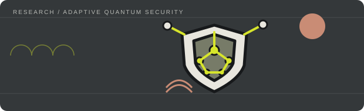
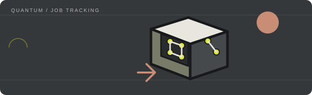
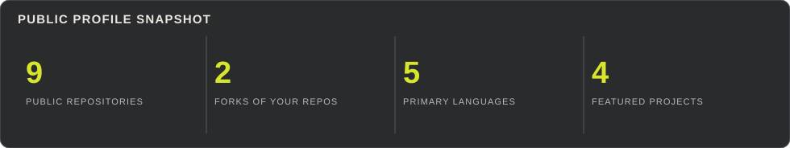
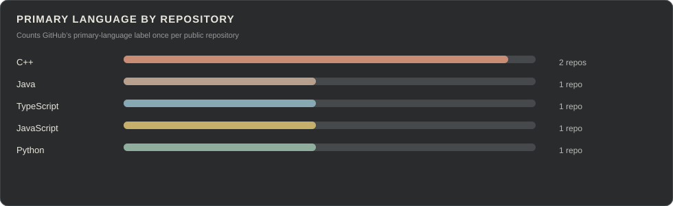

  

<h1 align="center">Hardhik</h1>

  <strong>Software Engineer | Distributed Systems &amp; Cloud</strong> 
  <a href="https://github.com/hardhik00007">GitHub</a>
  &nbsp;·&nbsp;
  <a href="https://www.linkedin.com/in/hardhik-yarlagadda-b38674325">LinkedIn</a>
  &nbsp;·&nbsp;
  <a href="mailto:yarlagaddahardhik@gmail.com">Email</a>

---

## About

I'm a Computer Science student interested in backend engineering, distributed systems, cloud infrastructure, and full-stack development. I like understanding how software behaves beyond the happy path: data flow, concurrency, failure handling, and the design decisions that make systems dependable.

## Selected work

<table>
  <tr>
    <td width="50%" valign="top">
      
      <h3><a href="https://github.com/hardhik00007/AQShield-">AQShield</a></h3>
      
A research prototype for adaptive quantum-secure communication, combining quantum and network simulation, attack modelling, benchmarking, and a React + TypeScript dashboard.

      TypeScript · Quantum computing · Simulation
    </td>
    <td width="50%" valign="top">
      
      <h3><a href="https://github.com/hardhik00007/Variable">Variable</a></h3>
      
A minimal JavaFX desktop file viewer and workspace for text, images, and PDFs, with tab reuse and drag-and-drop.

      Java · JavaFX · Maven
    </td>
  </tr>
  <tr>
    <td width="50%" valign="top">
      
      <h3><a href="https://github.com/hardhik00007/quantum-job-tracker">Quantum Job Tracker</a></h3>
      
A Streamlit dashboard to submit quantum circuits to IBM Quantum backends, track jobs, and inspect measurement results.

      Python · Streamlit · Qiskit
    </td>
    <td width="50%" valign="top">
      
      <h3><a href="https://github.com/karthikvemula1307/idea-incubator-">Idea Incubator</a></h3>
      
A collaborative MERN platform for students and mentors to organise ideas, projects, tasks, and progress updates.

      JavaScript · MERN · Collaboration
       Repository hosted under <code>karthikvemula1307</code>.
    </td>
  </tr>
</table>

## Technologies

**Languages:** C++ · Java · Python · JavaScript · TypeScript · SQL  
**Database:** MongoDB  
**Interests:** Backend systems · Distributed computing · Cloud infrastructure · Full-stack development

## GitHub activity

  

  

  

For the full contribution calendar, see the Activity section on my <a href="https://github.com/hardhik00007">GitHub profile</a>.
