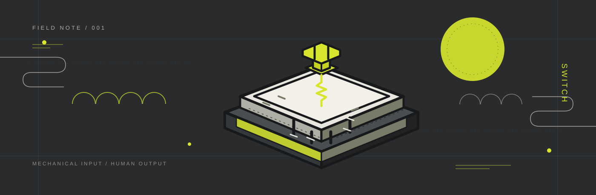

  
   
  

<h1 align="center">Hardhik</h1>

  <strong>Software Engineer | Distributed Systems &amp; Cloud</strong> 
  Building software, learning how systems behave, and occasionally finding out the hard way.

  <a href="https://github.com/hardhik00007">GitHub</a>
  &nbsp;·&nbsp;
  <a href="https://www.linkedin.com/in/hardhik-yarlagadda-b38674325">LinkedIn</a>
  &nbsp;·&nbsp;
  <a href="mailto:yarlagaddahardhik@gmail.com">Email</a>

---

### About

I'm a Computer Science student interested in the engineering behind reliable software: backend services, distributed systems, cloud infrastructure, and the interfaces that bring products together.

I enjoy working across the stack, but I'm especially interested in what happens beyond a successful API response: data flow, failure handling, concurrency, and the systems that keep applications running.

Currently exploring:

- Backend engineering and API design
- Distributed systems and cloud infrastructure
- Full-stack application development

### Selected work

| Project | What it is |
|:--|:--|
| [AQShield](https://github.com/hardhik00007/AQShield-) | A research platform for adaptive quantum secure communication. It brings together quantum and network simulation, adaptive decisions, attack modelling, benchmarking, and a React + TypeScript dashboard. *Research prototype.* |
| [Variable](https://github.com/hardhik00007/Variable) | A lightweight JavaFX desktop file viewer for UTF-8 text, images, and PDFs, with tab reuse, drag-and-drop, and local PDF rendering. |
| [Quantum Job Tracker](https://github.com/hardhik00007/quantum-job-tracker) | A Streamlit dashboard for submitting quantum circuits to IBM Quantum backends, tracking execution jobs, and inspecting measurement results. |
| [Idea Incubator](https://github.com/karthikvemula1307/idea-incubator-) | A MERN research-collaboration platform for students, mentors, and administrators to organise ideas, projects, tasks, and updates. *Repository hosted under `karthikvemula1307`.* |

### Tools I work with

**Languages**  
`C++` · `Java` · `Python` · `JavaScript` · `TypeScript` · `SQL`

**Data**  
`MongoDB`

**Areas**  
Backend systems · Distributed computing · Cloud infrastructure · Full-stack development

### GitHub activity

  
  

  

  

---

  Designed with a little signal, a little structure, and no unnecessary gradients.

